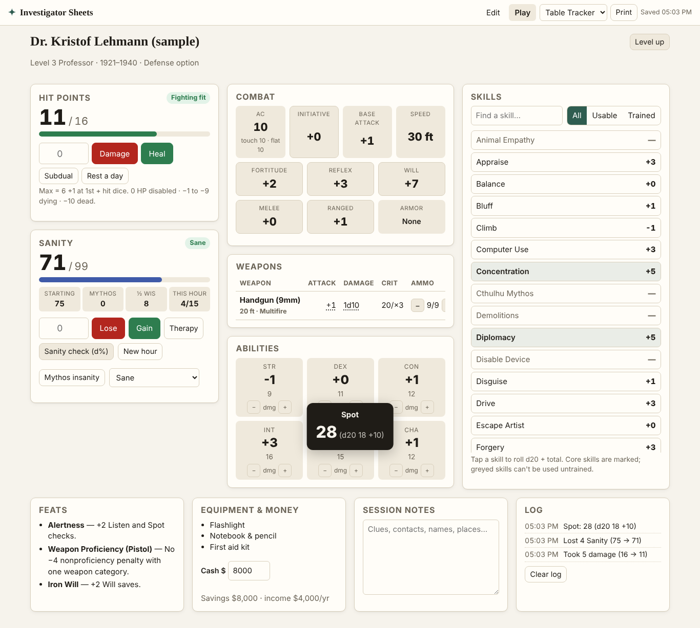
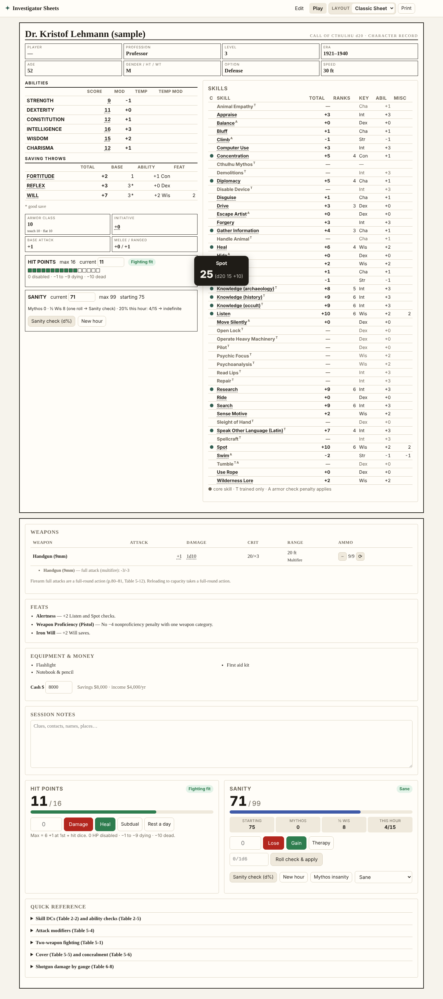
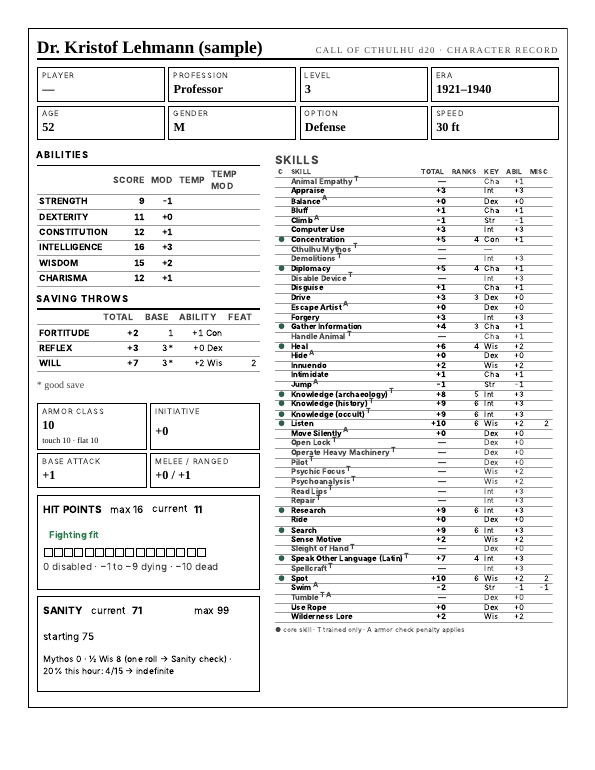
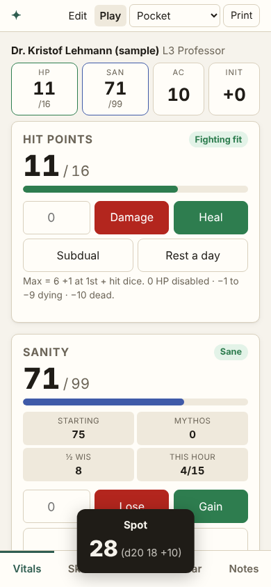
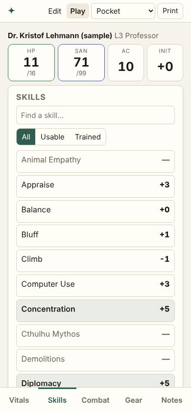
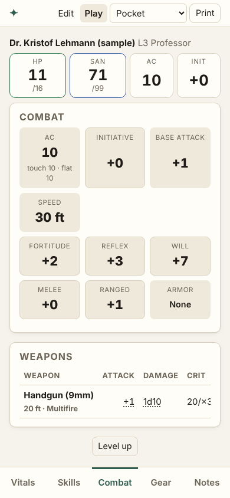
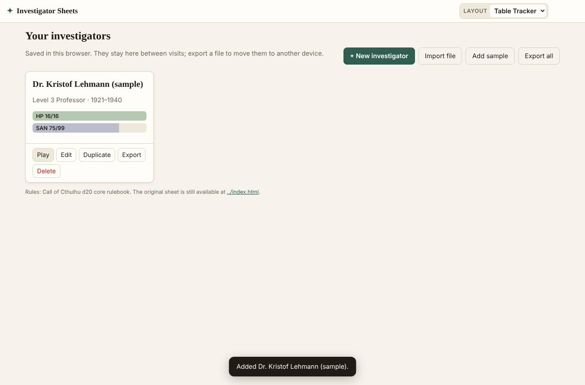
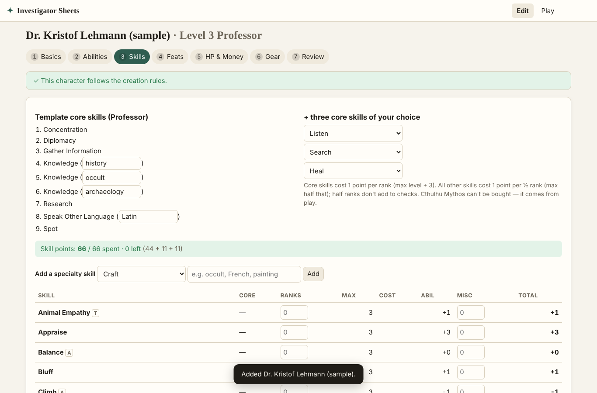

# Investigator Sheets (v2): designs and rules check

v2 is a rebuilt Call of Cthulhu d20 character sheet. It is now the default: the site root opens v2, and the original app stays available next to it.

| | Variant A (original) | Variant B (this) |
|---|---|---|
| Path | `/index.html` | `/v2/index.html` |
| Code | `script.js`, `equipment_functions.js` | `v2/js/rules.js` (rules), `store.js` (saving), `app.js` (list and editor), `designs.js` (play views) |
| Saved data | `localStorage["cocd20_characters"]` | `localStorage["cocd20v2:*"]`. B copies A's characters (any not copied before) when it opens, and leaves A's data untouched. |

Open `v2/index.html` in a browser; there is no build step. Run the rules tests with `node --test v2/tests/*.test.js`.

---

## Switching versions

Both versions have a slim **Version** bar at the top: Investigator Sheets (v2) or Original sheet (v1). **v2 is the default**: the main page (`/`) opens v2 unless this browser chose the original sheet. Add `?v1` to the address to force the original. Each version keeps its own saved characters. When v2 opens, it copies any v1 characters it hasn't copied yet; **Copy from original sheet** on the character list does the same on demand. Each copied character's Background notes list what to check (specialties, extra core skills, armor that isn't in Table 6-4, hit-die rolls).

## Saving characters

- Each character is saved in this browser automatically, about 0.3 s after every change, so there is no Save button to forget.
- **Your investigators** (`#/`) lists every saved character with HP and Sanity bars. The one you played last is highlighted, and the page reopens on that list.
- **Cookies** remember the last character opened (`cocd20_last`) and the play design you chose (`cocd20_design`). The character data itself lives in `localStorage`, because cookies hold only about 4 KB.
- **Browser history** works: each screen has its own address (`#/play/<id>`, `#/edit/<id>/skills`), so Back/Forward and bookmarks behave as you'd expect.
- **Export / Import** moves characters between browsers or devices as a `.json` file, either one character or all of them. Import also accepts files exported from variant A.
- If the browser blocks storage (some private modes), the list says so and asks you to export.

## The three play designs

All three draw from the same calculated sheet (`CoC.derive`), so every number is identical whichever you choose. Choose one with the **Layout** menu at the top of every page: the character list, the editor and the play screen. The choice is saved as your layout preference (cookie `cocd20_design`, plus `localStorage`), and every character opens in that layout when you press Play. You can switch layouts in the middle of a session without losing anything. **Print always produces the Classic Sheet layout.**

### 1. Table Tracker: laptop or tablet at the table

- Three columns: vitals (HP and Sanity with Damage/Heal/Lose/Gain), combat (AC, initiative, BAB, saves, weapons, abilities) and a searchable skill list.
- Tap any skill, save, ability, attack or damage entry to roll it. The result appears as a pop-up and in the log.
- Rule alerts appear at the top: dying, disabled, a Sanity check after losing ½ Wis, and 20%-per-hour indefinite insanity. The insanity alerts have buttons that roll Tables 4-1 to 4-4.
- **Roll check & apply** takes the book's loss notation (for example `1/1d6+1`). Pick one of the p.48 examples or type your own. The sheet rolls d% against current Sanity, then rolls and applies the success or failure loss.

### 2. Classic Sheet: record-sheet layout that prints on two pages

Printed (Letter): [PDF](docs/screens/design-2-sheet-print.pdf) · 

- Mirrors the official character record: identity boxes, abilities with temporary columns, saves with their base/ability/feat breakdown, AC/initiative/BAB, an HP box track, Sanity, and a full skill table (core ●, trained-only T, armor penalty A).
- Current HP and Sanity can be typed straight onto the sheet.
- Page 2 has weapons, feats, equipment, money and notes. The interactive HP and Sanity panels are hidden when printing.

### 3. Pocket: phone first
  

- A sticky strip shows HP, SAN, AC and INIT at all times.
- Large touch buttons, and five tabs at the bottom: Vitals, Skills, Combat, Gear and Notes.
- No sideways scrolling at 390 px wide.

### Character list and editor
 

The editor is a seven-step wizard: Basics, Abilities, Skills, Feats, HP & Money, Gear and Review. Every step shows live rule validation: red for rule problems, amber for reminders. **Level up** (from the play screen) rolls the hit die and +1d6 Sanity, then sends you to spend the new skill points, pick a feat at levels divisible by 3, and raise an ability at levels divisible by 4.

---

## How to confirm accuracy: worked sample

Click **Add sample** on the character list. The sample is **Dr. Kristof Lehmann**: a 3rd-level Professor, Defense option, good Reflex and Will saves, age 52, 1921–40 era, Alertness, Weapon Proficiency (pistol) and Iron Will.

Each line below is worked by hand from the rulebook and should match the sheet exactly. The test "Worked sample in v2/DESIGNS.md matches the hand calculation" in `v2/tests/rules.test.js` checks every value automatically.

| What | Working (printed page) | Expected |
|---|---|---|
| Ability scores | Rolled 10/12/13/15/14/11. Age 52 is middle age: −1 Str/Dex/Con, +1 Int/Wis/Cha (p.13) | Str 9 (−1), Dex 11 (+0), Con 12 (+1), Int 16 (+3), Wis 15 (+2), Cha 12 (+1) |
| Skill points | (8+3)×4 at 1st, then 8+3 at each of 2nd and 3rd (p.16) | 44 + 11 + 11 = **66** |
| Max ranks | Core: level + 3; noncore: half that (p.11) | Core 6, noncore 3 |
| Saves | Good 2 + ⌊L/2⌋ = 3; bad ⌊L/3⌋ = 1 (Table 1-8) | Fort 1+1 = **+2**; Ref 3+0 = **+3**; Will 3+2+2 (Iron Will) = **+7** |
| Base attack | Defense option ⌊L/2⌋ (Table 1-8) | **+1** |
| AC / initiative | 10 + Dex, no armor; Dex for initiative (p.61) | **10** / **+0** |
| Hit points | 6+1 at 1st; hit dice 4 and 3, each +1 Con (p.11) | 7 + 5 + 4 = **16** |
| Sanity | 5 × Wis 15; max 99 − 0 Mythos (p.47) | Starting/current **75**, max **99** |
| Temporary insanity trigger | Losing ½ Wis in one roll | **8** |
| Indefinite insanity trigger | 20% of current Sanity in one hour (p.49) | **15** |
| Money | d6 roll 4 + Professor 0 = ×4; era 1921–40 $2,000 / $1,000 (Tables 1-13, 1-14) | Savings **$8,000**, income **$4,000/yr** |
| Pistol attack | BAB 1 + Dex 0, proficient (p.43) | **+1**, 1d10, ×3 |
| Spot | 6 ranks + 2 Wis + 2 Alertness | **+10** |
| Knowledge (occult) | 6 ranks + 3 Int | **+9** |
| Drive (noncore) | 3 ranks (costs 6 points) + 0 Dex | **+3** |
| Swim | 0 ranks − 1 Str − 1 gear (pistol 2 + flashlight 1 + notebook 0.5 + first aid kit 3 = 6.5 lb → −1, p.37) | **−2** |

To exercise play mode: deal 17 damage and the sheet shows **−1, Dying**, with a 10% roll button. Deal 9 more and it shows **Dead** at −10. Lose 8 Sanity and an alert asks the GM for a Sanity check. Lose 15 within the same hour and the indefinite-insanity alert appears.

## Rules implemented and where to check them

| Rule | Source (printed page) | Code | Test |
|---|---|---|---|
| Ability modifier ⌊(score−10)/2⌋; reroll if total modifiers ≤ 0 or highest ≤ 13 | p.6–7 | `abilityMod`, editor Abilities step | — |
| Aging at 50/65/80, cumulative, minimum score 1 | Table 1-11, p.13 | `agingCategory`, `abilityScores` | ✓ |
| Defense/Offense saves and BAB, iterative attacks at −5 | Tables 1-8 and 1-9, p.10 | `baseSave`, `baseAttackBonus`, `attackSequence` | ✓ |
| Exactly 1 (Offense) or 2 (Defense) good saves | p.10 | `validate` | ✓ |
| Feats: 2 at 1st, +1 at levels divisible by 3; ability +1 at levels divisible by 4 | Table 1-10, p.11 | `featSlots`, `abilityIncreaseLevels` | ✓ |
| HP: 6 + Con, then 1d6 + Con per level (min 1); Toughness +3, stacks | p.11, p.42 | `hitPoints` | ✓ |
| HP states: 0 disabled, −1…−9 dying (10% roll each round), −10 dead; Heal DC 15 stabilizes; rest heals 1/level/day | p.69 | `hpState`, play actions | ✓ |
| 12 core skills (9 template + 3 choice); specialties are separate skills | p.11–13, p.16 | `templateCore`, `validate` | ✓ |
| Skill points (8+Int)×4, then 8+Int per level (min 1); core 1 pt/rank; noncore 1 pt per ½ rank; half ranks don't count | p.16–18 | `skillPoints`, `skillTable` | ✓ |
| Trained-only skills, key abilities, armor-penalty skills | Table 2-1, p.18 | `SKILLS` | ✓ |
| Synergy +2 at 5 ranks | Table 2-4, p.22 | `SYNERGIES` | ✓ |
| Cthulhu Mythos can't be bought, has no max; max Sanity = 99 − (ranks + bonuses) | p.18, p.27, p.47 | `mythos` field, `sanity` | ✓ |
| Swim −1 per 5 lb of gear; no other encumbrance rule exists | p.37 | `gearWeight`, `skillTable` | ✓ |
| Feat prerequisites, choices, multi/stacking; aptitude bonuses don't stack | Tables 3-1, 3-2, p.39–45 | `FEATS`, `featPrereqIssues` | ✓ |
| Weapon Proficiency by category (nonproficient −4); Finesse, Focus, Improved Critical | p.40–43 | `weaponAttack` | ✓ |
| Armor: AC bonus and check penalty (to skills and attacks); no Max Dex | Table 6-4, p.94–95 | `ARMOR`, `combat` | ✓ |
| Weapon stats | Tables 6-1 and 6-3, p.94–95 | `WEAPON_PRESETS` | — |
| Sanity: start 5×Wis, max 99−Mythos, ½ Wis per roll → check, 20%/hour → indefinite, 0 → slide, −10 permanent, +1d6 per level (cap at max), therapy capped at starting, Mythos insanity +2 then +1 | p.47–51 | `sanity`, `loseSanity`, `gainSanity`, `mythosInsanity` | ✓ |
| Money: (1d6 + profession, min 1) × era; Wealth windfall and +2 income | Tables 1-13 and 1-14, p.15, p.42 | `money` | ✓ |
| Insanity: Table 4-1 duration, 4-2/4-3 effects (00 on 4-2 goes to 4-3), 4-4 disorder plus 1d6 months; Sanity checks with "success/failure" loss notation and the p.48 examples | Tables 4-1 to 4-4, p.48–50 | `sanityCheck`, `rollTemporaryInsanity`, `rollIndefiniteInsanity` | ✓ |
| Specific firearms; shotgun damage by gauge | Tables 6-5 and 6-8, p.98–99 and p.107 | `SPECIFIC_FIREARMS`, `SHOTGUN_DAMAGE` | ✓ |
| Random height and weight | Table 1-12, p.14 | `rollHeightWeight` | ✓ |
| Firearm full attacks: standard/multifire/autofire extra attacks and penalties, Rapid Shot, Multishot, 3 bullets per autofire attack | p.80–81, Table 5-12 | `firearmFullAttack` | ✓ |
| Two-weapon penalties | Table 5-1, p.67 | `TWO_WEAPON` | ✓ |
| Natural 20/1 on attack rolls only | p.19, p.66 | `rollD20` (app.js) | — |
| Play reference: DCs, ability checks, attack modifiers, cover, concealment | Tables 2-2, 2-5, 5-4, 5-5, 5-6 | `DC_EXAMPLES`, `ATTACK_MODIFIERS`, `COVER`, `CONCEALMENT` | ✓ |
| Variant defense bonus (+ Offense bonus Weapon Proficiency; house-rule switch to grant it always) | Table 1-15, p.15 | `defenseBonus`, `offenseBonusFeat`, `featSlots` | ✓ |
| XP thresholds: 1,000 × level × (level − 1) / 2 | Table 1-10, p.11 | `xpForLevel` | ✓ |
| Ability score 0: Con dead, Str/Dex can't move, Int/Wis/Cha helpless | p.62 | `derive().abilityZero` | ✓ |
| Ability damage heals 1 point per day of rest per damaged ability; drain is permanent | p.74, p.128 | Rest a day, `abilityDrain` | ✓ |
| Conditions: blinded, cowering, deafened, entangled, exhausted, fatigued, flat-footed, grappled, helpless, nauseated, paralyzed, prone, stunned — ability, attack, initiative, speed and Dex-to-AC effects; the most severe applies | Character Condition Summary, p.91 | `CONDITIONS`, `conditionEffects`, `combat` | ✓ |
| Spells: no magic points; cost is Sanity plus ability damage or permanent drain, paid when casting completes; save DC 15 + Int bonus; Unmastered Magic variant | p.126–128, p.151 | `parseSpellCost`, `spellSaveDC`, play actions | ✓ |
| Tomes: initial Sanity loss; study check 1d20 + level + Int + earlier checks vs DC; completion Sanity loss and Mythos ranks; consulting a read tome | p.119–121 | `tomeStudyBonus`, play actions | ✓ |

**Data provenance.** Every rule table the app uses has been checked against the rulebook page images:
- Tables 1-8 to 1-15, the profession templates, 2-1, 2-4, 3-1, 3-2, 6-1, 6-3, 6-4 and 6-5, plus the Sanity and combat rules, are in `docs/rulebook/EXTRACTION_REVIEW.md` §2.
- Tables 1-12, 2-2, 2-5, 4-1 to 4-4, 5-4, 5-5, 5-6 and 6-8, plus the Sanity Loss Examples and the Helpless Defenders rules, are in the addendum (§5).

Tables 5-1 (two-weapon penalties) and 5-12 (firearm full attacks) were also checked and are on the sheet. The only 5-x tables not on the sheet are GM tables, not character-sheet rules:
- actions (5-2)
- size (5-3)
- objects (5-7 to 5-11)
- multiple ranged attacks (5-12)
- disease (5-13)
- invisibility (5-14)
- poison (5-15)
- wind, falling objects and weather (5-16 to 5-18)

## Rulebook ambiguities and how they are resolved

The source has a few inconsistencies. Each one below is resolved from the rulebook's own text, and the resolution is covered by a test. Where a group may prefer something else, the sheet offers a clearly labelled house-rule switch, defaulting to rules as written.

| # | Issue | Resolution | Evidence |
|---|---|---|---|
| 1 | Armor check penalty on **Swim**: the armor sidebar (p.94) lists 7 skills without Swim | **Applies.** The sidebar is an incomplete summary. | Table 2-1 marks Swim †† (p.18), and the Swim entry header reads "SWIM (STR; ARMOR CHECK PENALTY)" (p.37). Every other skill entry with that header matches the 8 skills the sheet uses. |
| 2 | **Swim and gear weight** | **−1 to Swim per 5 lb of gear carried or worn**, from the weights entered on the Gear step | Swim, Special (p.37). It is the only gear-weight rule for investigators. |
| 3 | **Encumbrance / carrying capacity** | **Not applied.** The rulebook has no investigator carrying-capacity table, so v2 invents none. The original app's Str×3/×6/×10 loads are not from this book. | A full-text search finds carrying capacity only in animal stat blocks (horse, camel). |
| 4 | **Agent template prints "Computer Use [Cha]"** (p.12) | **Int.** A skill's key ability belongs to the skill. | "The key ability of a skill is noted in its description and on Table 2-1" (p.17). Table 2-1 and the other three templates with Computer Use say Int. |
| 5 | **Maximum Sanity: "99 − Mythos ranks" or "99 − Mythos modifier"** | **99 − (Mythos ranks + any Mythos bonus).** Mythos has no key ability, so its modifier is ranks plus bonuses, which satisfies both wordings. Enter a bonus as the Mythos "misc". | p.47: "This number (99 minus Cthulhu Mythos ranks and any bonuses) is the character's maximum Sanity." The worked example on p.50 (99 − 3 ranks = 96) agrees. |
| 6 | **"Loses one-half her Wisdom score"** with an odd Wisdom | **A loss of at least half.** Wis 15 means 7.5, so a loss of 8 triggers it. | p.47 |
| 7 | **Skill points after an Int increase** | **Not retroactive.** The sheet records the Int modifier at each level; levels gained after an increase get the new value. | p.9 (Claire's example) |
| 8 | **Natural 20 / natural 1** | **Attack rolls only:** a natural 1 always misses; a natural 20 always hits and is a critical threat; any roll in the weapon's threat range is a threat. Skill, ability and save rolls show the plain total. | Skills: "A natural 20 is not an automatic success, and a natural 1 is not an automatic failure" (p.19). Attacks: p.66. The book gives no automatic results for saves. |
| 9 | **Shotgun critical:** the generic 12-gauge in Table 6-3 is ×3, but Table 6-8 gives 12-gauge ×4 | Each preset keeps its own table's value: the generic shotgun ×3; the specific shotguns (12-gauge buckshot) ×4, with slug and birdshot damage in their notes. | p.95, p.107 |
| 10 | **Table 1-12 example:** Sam's 2d4 roll is printed as 5, but the arithmetic uses 6 (12 × 6 = 72 lb) | The formula is applied as written: base + (height roll × weight roll). | p.14 |
| 11 | **Offense option's extra Weapon Proficiency** is printed only inside the Defense Bonus variant box (p.15) | **Rules as written: it comes with the variant** (confirmed by the project owner). The sentence sits inside the variant box and says it is there "to balance the two options" once Defense characters get the bigger AC bonus. A clearly labelled **house rule** on the Basics step grants it always, for groups that want that. | p.15 |
| 12 | **Multishot with standard fire:** the feat text (p.41) mentions only autofire and multifire, but the Standard rule (p.81) and Table 5-12 also reduce the standard full-attack penalty by 2 | **Table 5-12 and p.81 are followed:** Multishot reduces every firearm full-attack penalty by 2. The feat text in the sheet says so. | p.41, p.80–81 |

## A/B deployment

- **GitHub Pages (simplest).** Serve the repository root. Players reach A at `/` and B at `/v2/`. Both keep their own storage keys, so testers can use both in the same browser.
- **Split by link.** Give half the table the A link and half the B link, and compare: time to build a character, errors the GM catches, and which design players keep using during a session.
- **Done:** B won, and `/` now sends players to `v2/` unless they chose A. A's saved characters are copied into B automatically.
